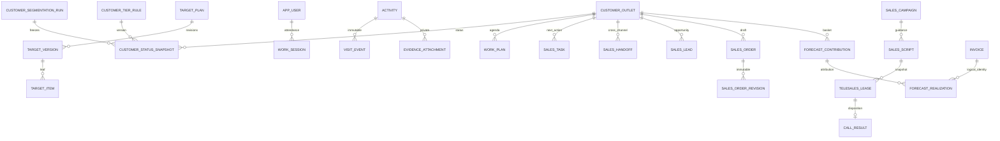

# ERD implementasi lokal M2

18 Oktober 2026. Delta terhadap ERD produk v1.2. DDL aktual ada pada migrations 0018–0030, bukan klaim semua entitas rancangan telah dibangun. [Inventaris fisik JSON](ERD_M2_Implementation.json) dibuat dengan mengeksekusi seluruh migrasi pada SQLite kosong, lalu membaca kolom, indeks dan foreign key. Tabel yang sudah ada dan diubah M2: target_plan, target_item, activity.

Graf menunjukkan relasi logis, bukan jaminan seluruh garis mempunyai constraint FK fisik. Setiap query memakai organization_id serta scope. Relasi invoice mengikuti identitas sumber dan revisi current, sehingga revisi/retur tidak menggandakan actual. Tabel snapshot dan event mempunyai trigger immutable.

Target menyimpan leaf pelanggan ATAU sales rep, basis revenue/produk/group, snapshot area/rep/kanal/hirarki. Parent dan reserve bukan tambahan leaf actual. Satu plan approved per kanal pada periode beririsan merupakan batas pilot.

Forecast sales dan alternatif manager adalah dua pandangan terpisah. Satu basket aktif per customer/kanal/view/bulan. Omitted membebaskan basket; merge/revisi invoice yang ambigu menahan angka untuk review. Confirmed order belum menjadi invoice.

Script pada lease dan hasil panggilan dibekukan dengan versinya. Mutasi script berikutnya tidak mengubah qualification pada lease aktif. Evidence hanya metadata di D1; byte disimpan di R2 privat, melalui API autentikasi.

Tidak ada relasi Account bisnis/legal. Alias pelanggan dan seluruh fakta keuangan lama dipertahankan. Android/GPS background dan tabel finalisasi insentif tidak termasuk slice M2 ini.
