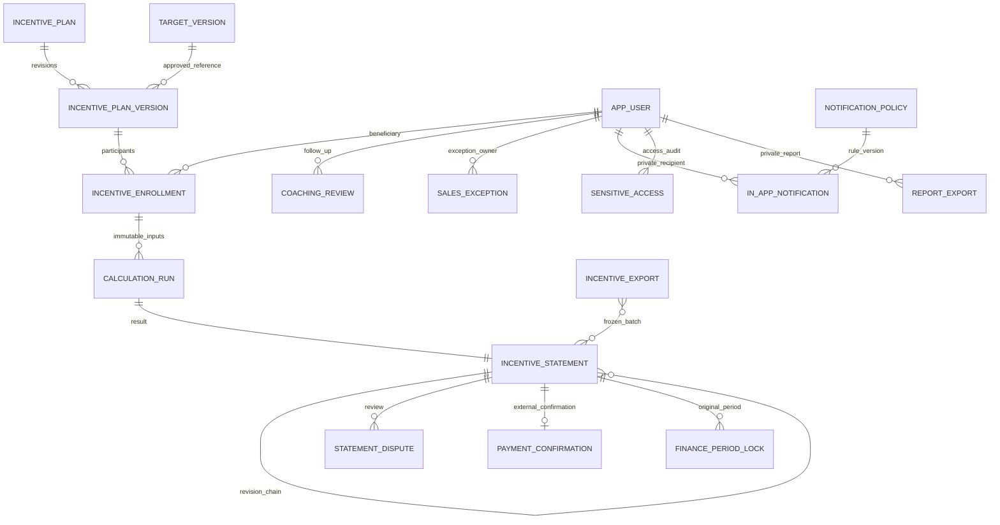

# ERD implementasi M3

18 Oktober 2026. Delta fisik migrations 0031–0032, dengan [inventaris kolom/index/FK JSON](ERD_M3_Implementation.json). Seluruh migrasi dieksekusi pada SQLite kosong sebelum introspeksi; grafik berikut adalah hubungan logis, bukan klaim seluruh relasi mempunyai FK fisik. Scope organisasi, penerima, periode, state dan versi juga diperiksa server.

Plan version menyimpan rules JSON bertipe, target version, periode, timezone, role dan kanal. Enrollment membekukan leaf target, area dan penerima. Satu skema utama aktif per peserta pada periode beririsan; revisi plan meretire enrollment lama, bukan menghapusnya.

Calculation run menyimpan input/hasil immutable: aturan, target, invoice/credit current, cutoff, atribusi primer, review flags, exact rational component dan angka desimal sebelum half-up total rupiah. Tidak ada mutasi actual melalui simulasi.

Statement mempunyai revision_no, previous_statement_id, entitlement penuh serta payable_delta terhadap hak terakhir yang difinalkan pada peserta/periode. Recalculation draft juga membuat statement baru dan menandai draft lama superseded. Finalized/exported/paid tetap tersedia. Export snapshot dan payment confirmation terpisah; tidak ada transfer uang atau potongan payroll otomatis.

Dispute terbuka atau accepted yang masih mereferensikan run sama menahan finalisasi. Finalisasi membuat finance_period_lock agar revisi invoice berikutnya mempunyai provenance adjustment periode asli.

Evidence invoice/credit dan component disimpan dalam JSON run, bukan membuat salinan tabel invoice baru. Report CSV byte berada di R2 privat; D1 hanya metadata/checksum/cutoff/filter/expiry. Notification hanya in-app, dengan trigger+rule version unik dan quiet hours timezone penerima. Tidak ada Account bisnis/legal aktif.
