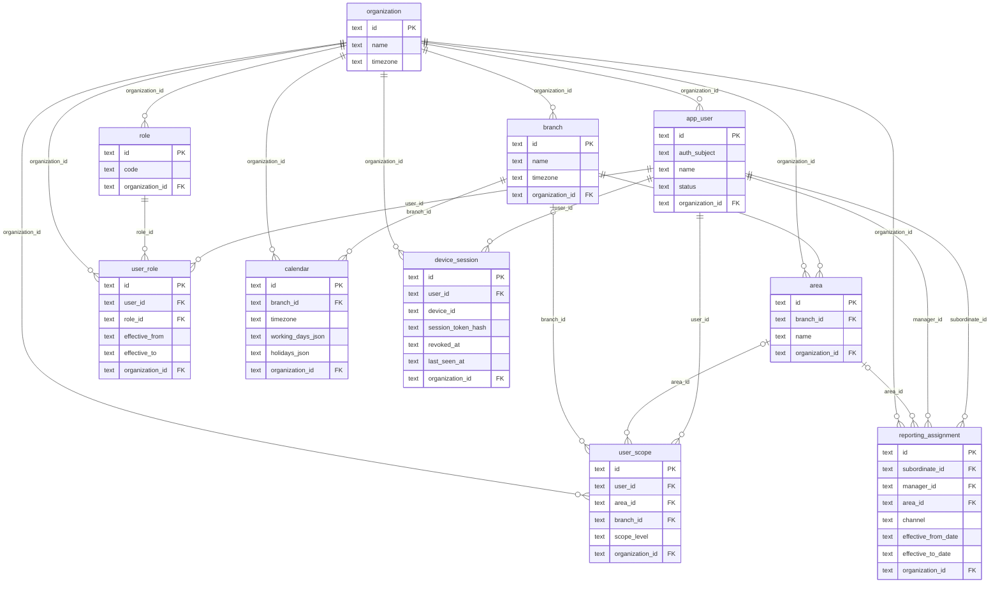
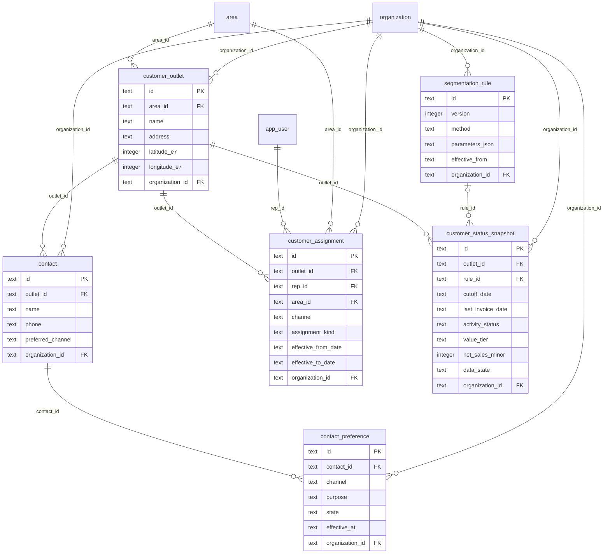
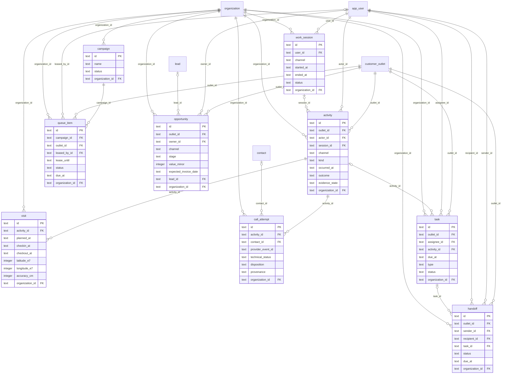
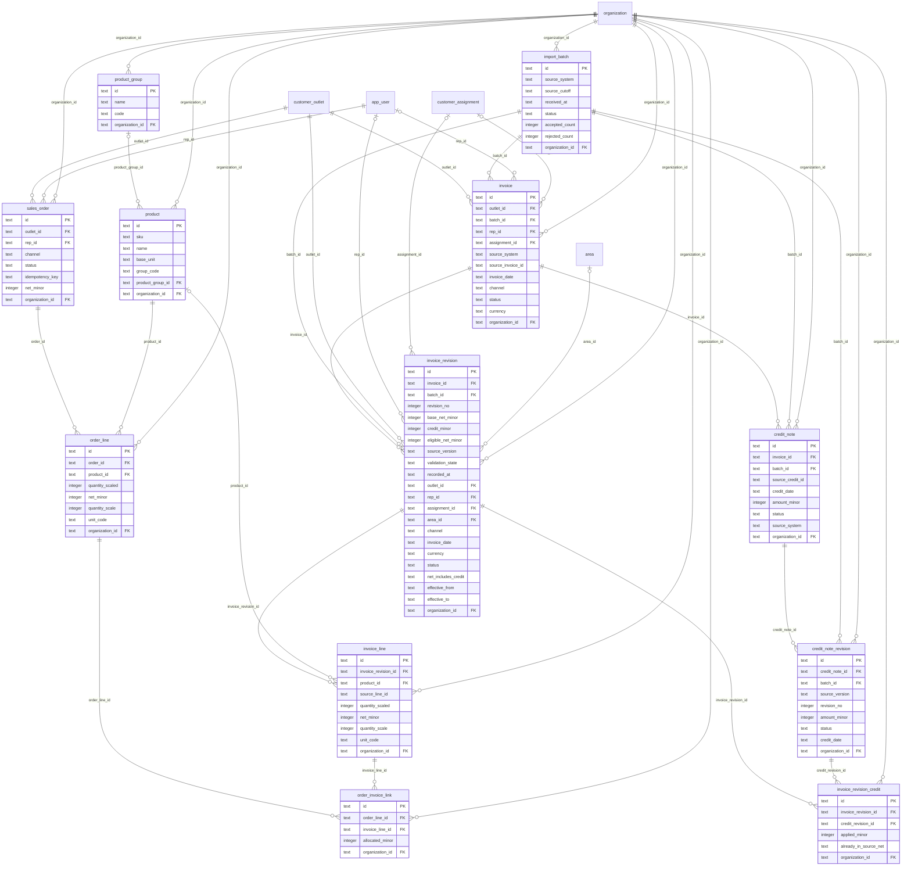
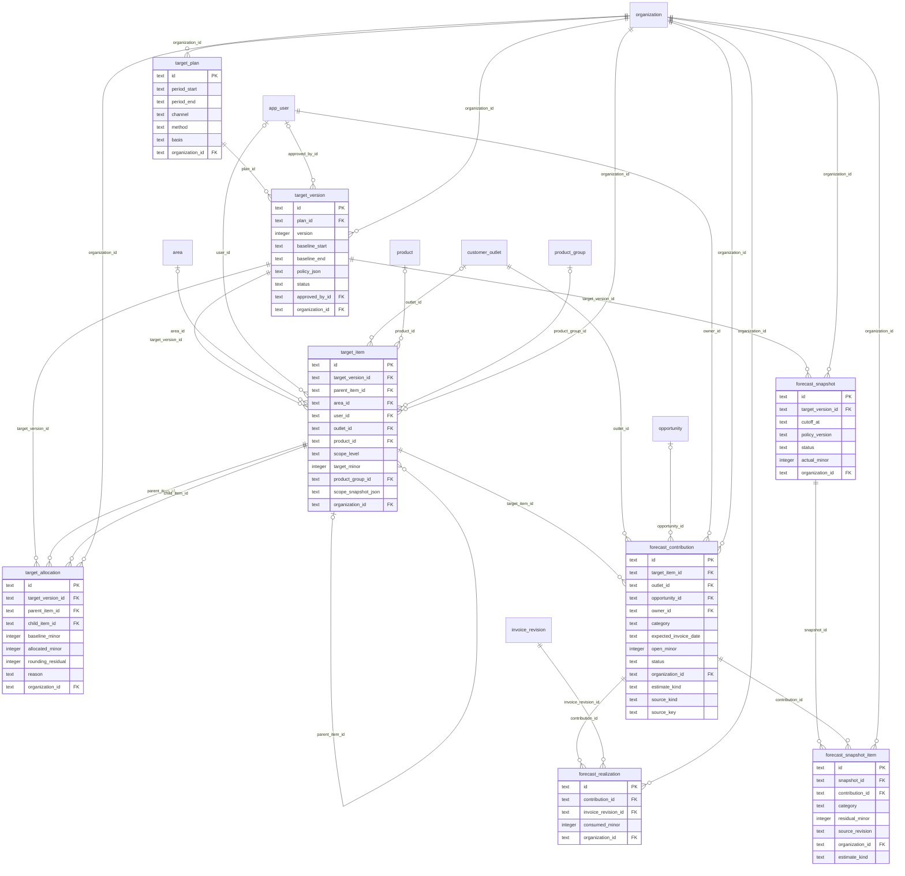
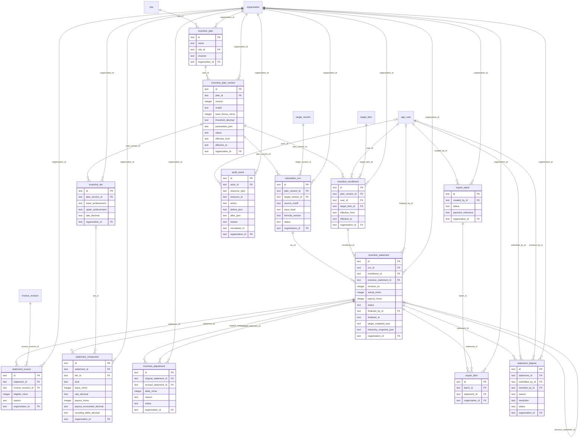
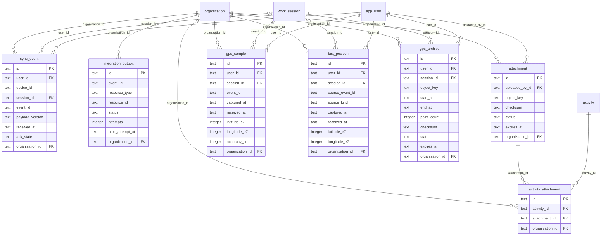

# ERD NYALES v1.2

Acuan PRD v1.10. Rancangan produk lengkap; schema implementasi lokal ditentukan migrations dan erd-m1-delta.json. Tidak semua tabel rancangan sudah dibangun.

Keputusan 18 Oktober 2026: pelanggan/toko adalah entitas utama, satu pelanggan = satu lokasi. Lapisan Account bisnis/legal dihapus dari schema aktif, UI, API dan import. Kontak, assignment kanal, transaksi, target dan histori mengacu langsung ke pelanggan. Kode ERP opsional pada input manual, wajib dan unik dalam organisasi untuk import pelanggan. Pengaturan tetap hanya Management/NSM. Istilah account untuk identitas login, kuota provider atau Android developer tidak berarti entitas pelanggan.

Migrasi lokal 0017 menyimpan master dan relasi Account lama sebagai snapshot audit, menghapus tabel account/kolom account_id, dan mewajibkan validasi ulang batch import pelanggan lama. Dokumen ini menggantikan baseline sebelumnya untuk arsitektur pelanggan; status produksi tetap terpisah.

## Organisasi dan akses



| Tabel | Catatan |
|---|---|
| organization |  |
| branch |  |
| area |  |
| app_user | Identitas Firebase dipetakan ke user internal; auth_subject unik per provider/organisasi. |
| role | Kode: MANAGEMENT, NSM, AREA_MANAGER, SUPERVISOR, SALES_REP, TELESALES; admin teknis tidak otomatis memperoleh pengaturan bisnis. |
| user_role |  |
| user_scope | Area/branch nullable menurut scope_level; ORG hanya Management/NSM. CHECK scope_level memastikan kombinasi field sah. |
| reporting_assignment | Satu SR tepat satu SPV aktif; periode tidak overlap; hirarki tidak siklik. SPV/AM tidak wajib memiliki visit. Effective date business-local [from,to) menjadi acuan invoice date; timestamp perubahan tetap diaudit. |
| calendar | Konfigurasi Management/NSM; hari kerja dipakai SLA dan cadence. |
| device_session | Sesi API tambahan untuk revocation per device; JWT Firebase bukan identitas device unik. |

## Customer dan distribusi



| Tabel | Catatan |
|---|---|
| customer_outlet | Satu pelanggan/toko = satu lokasi. Tidak ada parent Account bisnis/legal. Area saat ini dan histori assignment dipisahkan; invoice dan fakta historis mempertahankan atribusi asal. |
| contact |  |
| customer_assignment | Owner lapangan primer tunggal per outlet pada satu waktu. Penugasan telesales terpisah dari owner lapangan; invoice tetap satu kanal primer. Effective date business-local [from,to) menjadi acuan invoice date; timestamp perubahan tetap diaudit. |
| segmentation_rule | Metode nominal/percentile/custom tervalidasi; basis hanya penjualan invoice. Rule aktif immutable. |
| customer_status_snapshot | Status Active bila last_invoice_age_days <= 90. Churn bila >90; customer belum pernah bertransaksi ditandai New/needs-baseline, bukan disamakan dengan churn tanpa informasi. Tier Low/Mid/High dipisahkan dari status; snapshot tidak mengubah histori. |
| contact_preference | DNC/consent/suppression memiliki histori dan sumber perubahan. |

## Aktivitas dan pekerjaan



| Tabel | Catatan |
|---|---|
| work_session |  |
| activity |  |
| visit | activity_id unik; subtype activity. Jadwal rencana dapat disimpan sebelum check-in. |
| call_attempt | activity_id unik; provider technical status berbeda dari outcome deklarasi agent. |
| campaign |  |
| queue_item | Claim atomik; satu lease aktif atas item eligible; DNC diperiksa sebelum penugasan. |
| task |  |
| handoff | Tidak memindahkan owner dan tidak memberi penjualan tambahan otomatis. |
| opportunity |  |

## Transaksi invoice



| Tabel | Catatan |
|---|---|
| product |  |
| import_batch | Kesalahan mapping disimpan sebagai staging/error batch; tidak dipaksakan masuk fact tervalidasi. |
| sales_order |  |
| order_line |  |
| invoice | Identitas invoice unik per org/sumber. rep/assignment boleh null selama needs_review, wajib sah sebelum eligible. Tanggal invoice dan Sales Rep sumber dipertahankan. |
| invoice_revision | Immutable: eligible_net = base_net - credit yang belum termasuk base. Tepat satu revisi efektif dipilih per invoice/cutoff; histori final calculation mereferensikan revisi, bukan nilai latest. Snapshot dimensi customer/rep/area/channel/date wajib; perubahan identitas header tidak mengubah kalkulasi lama. |
| invoice_line | Total header tidak dijumlahkan per line. Detail produk hanya valid bila line tersedia dan rekonsiliasi lulus. |
| credit_note | Unique per org/sumber/credit ID. Credit sudah termasuk net sumber tidak dikurangkan kembali. |
| order_invoice_link | Order/invoice dapat parsial dan banyak-ke-banyak; nilai alokasi tidak boleh melebihi sumber. Tidak wajib bila invoice sumber tidak membawa link order. |
| product_group | Kelompok produk target/KPI; kode unik per organisasi. |
| credit_note_revision | Credit correction append-only; source ID idempotent; applied amount and source net definition frozen in invoice revision. |
| invoice_revision_credit | Menyimpan credit revision yang dipakai pada invoice revision; unique pasangan; credit yang sudah termasuk net sumber tidak dikurangi lagi. |

## Target dan forecast



| Tabel | Catatan |
|---|---|
| target_plan |  |
| target_version | Bottom-up/top-down merupakan alternatif, hanya satu versi aktif per scope/kanal/periode. Target yang disahkan immutable. |
| target_item | Scope_level menentukan subject: ORG/AREA/USER/OUTLET; product opsional sebagai dimensi. Rollup memilih leaf atau parent, bukan keduanya. USER scope dapat mewakili SR/SPV/AM; agregasi memakai snapshot subtree role. Jangan menjumlahkan node target overlap; PRODUCT atau PRODUCT_GROUP eksklusif. |
| target_allocation | Snapshot baseline, histori tiga bulan selesai dan onboarding input. Tidak menggunakan realisasi masa depan untuk target awal. |
| forecast_contribution | Repeat order boleh tanpa opportunity; contribution ID tetap unik. Owner estimate dan manager alternative dibedakan, tidak dijumlahkan. |
| forecast_realization | Hanya nilai eligible pada basis sama mengonsumsi residual; invoice baru tidak menaikkan actual+residual dua kali. Revisi invoice baru mensupersede alokasi revision lama untuk view latest, tidak keduanya ditambahkan. Manager alternative dan rep forecast tidak digabung; snapshot menyimpan estimate_kind. |
| forecast_snapshot | Snapshot immutable setelah submit; actual cutoff dan hierarchy version dibekukan. |
| forecast_snapshot_item | Membekukan kategori/nilai kontribusi saat snapshot; perubahan berikutnya tidak menulis ulang snapshot lama. |

## Insentif dan audit



| Tabel | Catatan |
|---|---|
| incentive_plan |  |
| incentive_plan_version | Plan per role/kanal; template progressive plus bonus, whole-basis dan model lain dipisahkan eksplisit. |
| incentive_tier | Batas dan rate memakai decimal string/canonical scaled integer; bukan float. Upper null berarti tanpa batas atas. |
| incentive_enrollment | Penerima harus sesuai role/kanal/scope target. Membership dibekukan dalam run. |
| calculation_run | Run key mencakup policy, target, peserta dan source snapshot; retry identik tidak membuat entitlement ganda. |
| incentive_statement | Finalisasi tombol manual Management/NSM; larangan self-approval. Revision mengacu statement lama; exported bukan paid. |
| statement_source | Menyimpan input invoice exact; invoice bukan disalin ke payout kedua. Nilai source dapat ditelusuri per penerima. |
| statement_component | Nilai decimal unrounded disimpan; pembulatan half-up pada total statement. Selisih tampilan pembulatan dicatat eksplisit, tidak mengubah total. |
| incentive_adjustment | Selisih entitlement original vs revised; tidak dipotong/dibayar otomatis. |
| export_batch |  |
| export_item | Export ulang mengacu revision yang sama; tidak membuat hak pembayaran baru. |
| audit_event | resource_type/resource_id adalah referensi audit generik tanpa FK fisik lintas tabel; actor boleh null untuk system job. |
| statement_dispute | Dispute terbuka menahan finalisasi; deadline policy disimpan. |

## Sinkronisasi dan Android



| Tabel | Catatan |
|---|---|
| sync_event | Unique org/device/event untuk retry; received_at berbeda dari captured_at. |
| integration_outbox |  |
| attachment |  |
| activity_attachment | Link eksplisit menjamin bukti activity tidak hilang tanpa jejak. |
| gps_sample | Tahap Android. D1 hot tujuh hari; titik bukan bukti visit otomatis. |
| last_position | UNIQUE org/user; event terlambat tidak memundurkan posisi. source_event_id bukan FK wajib ke gps hot karena arsip/expiry. |
| gps_archive | Manifest di D1, payload R2 privat. Verified count/digest/readback sebelum hapus hot; legal hold mengalahkan expiry. |

## Operasional pendukung web

```mermaid
erDiagram
    direction TB
    work_plan {
        text id PK
        text owner_id FK
        text period_start
        text period_end
        text status
        integer revision_no
        text organization_id FK
    }
    plan_item {
        text id PK
        text plan_id FK
        text outlet_id FK
        text assignee_id FK
        text activity_id FK
        text due_at
        text status
        text organization_id FK
    }
    lead {
        text id PK
        text outlet_id FK
        text owner_id FK
        text channel
        text source
        text status
        text response_due_at
        text organization_id FK
    }
    script_version {
        text id PK
        text campaign_id FK
        integer revision_no
        text content_json
        text status
        text organization_id FK
    }
    exception_case {
        text id PK
        text owner_id FK
        text outlet_id FK
        text resource_type
        text resource_id
        text kind
        text status
        text due_at
        text resolution
        text organization_id FK
    }
    coaching_note {
        text id PK
        text rep_id FK
        text coach_id FK
        text task_id FK
        text note
        text review_at
        text organization_id FK
    }
    notification {
        text id PK
        text user_id FK
        text trigger_key
        text payload_json
        text read_at
        text organization_id FK
    }
    automation_rule {
        text id PK
        text name
        integer revision_no
        text rule_json
        text status
        text organization_id FK
    }
    job {
        text id PK
        text requested_by_id FK
        text kind
        text status
        text input_hash
        text checkpoint_json
        text result_resource_id
        text organization_id FK
    }
    import_row {
        text id PK
        text batch_id FK
        integer row_no
        text payload_json
        text errors_json
        text status
        text organization_id FK
    }
    approval_policy {
        text id PK
        text kind
        integer revision_no
        text rules_json
        text status
        text organization_id FK
    }
    approval_request {
        text id PK
        text policy_id FK
        text order_id FK
        text submitted_by_id FK
        text decided_by_id FK
        text status
        text reason
        text decided_at
        text organization_id FK
    }
    idempotency_record {
        text id PK
        text user_id FK
        text method
        text path
        text key
        text request_hash
        text response_json
        text expires_at
        text organization_id FK
    }
    app_user ||--o{ work_plan : owner_id
    work_plan ||--o{ plan_item : plan_id
    customer_outlet ||--o{ plan_item : outlet_id
    app_user ||--o{ plan_item : assignee_id
    activity |o--o{ plan_item : activity_id
    customer_outlet |o--o{ lead : outlet_id
    app_user ||--o{ lead : owner_id
    campaign ||--o{ script_version : campaign_id
    app_user ||--o{ exception_case : owner_id
    customer_outlet |o--o{ exception_case : outlet_id
    app_user ||--o{ coaching_note : rep_id
    app_user ||--o{ coaching_note : coach_id
    task |o--o{ coaching_note : task_id
    app_user ||--o{ notification : user_id
    app_user |o--o{ job : requested_by_id
    import_batch ||--o{ import_row : batch_id
    approval_policy ||--o{ approval_request : policy_id
    sales_order ||--o{ approval_request : order_id
    app_user ||--o{ approval_request : submitted_by_id
    app_user |o--o{ approval_request : decided_by_id
    app_user ||--o{ idempotency_record : user_id
    organization ||--o{ work_plan : organization_id
    organization ||--o{ plan_item : organization_id
    organization ||--o{ lead : organization_id
    organization ||--o{ script_version : organization_id
    organization ||--o{ exception_case : organization_id
    organization ||--o{ coaching_note : organization_id
    organization ||--o{ notification : organization_id
    organization ||--o{ automation_rule : organization_id
    organization ||--o{ job : organization_id
    organization ||--o{ import_row : organization_id
    organization ||--o{ approval_policy : organization_id
    organization ||--o{ approval_request : organization_id
    organization ||--o{ idempotency_record : organization_id
```



| Tabel | Catatan |
|---|---|
| work_plan | Snapshot agenda; perubahan menghasilkan versi. |
| plan_item | Snapshot denominator completion dan kapasitas. |
| lead | Prospect boleh belum cocok outlet; conversion membuat link tanpa kehilangan histori. |
| script_version | Script/qualification schema versi Management. |
| exception_case | Link generik diaudit; tidak menggantikan validasi izin resource. |
| coaching_note | Coaching menurut hirarki tanpa hak ubah parameter bisnis. |
| notification | Trigger unik per rule/version/recipient/event; quiet hours. |
| automation_rule | Rule terbatas tervalidasi; tidak mengeksekusi kode bebas. |
| job | Job async/import/export/calculation dengan owner, checkpoint, count dan result. |
| import_row | Staging boleh invalid; tidak masuk fact sampai valid; payload PII dibatasi retensi. |
| approval_policy | Harga/kredit/order; Management mengatur rule. |
| approval_request | Nilai dan policy disnapshot; perubahan material memerlukan approval ulang; no self approval. |
| idempotency_record | Unique org/user/method/path/key; payload mismatch 409; mutation+record atomic. |

## Constraints

```json
[
  "All FK composite organization_id+id; cross-tenant rejected.",
  "Unique source invoice+source_version, credit+source_version.",
  "Immutable revision and final snapshots; temporal overlap and cycle checks on mutations.",
  "target_version matches target_item; contribution realization latest selects one revision per source.",
  "User scope enforced by backend, not only ERD.",
  "Target date interval and product/group dimensions validated, no overlapping rollup."
]
```

## Wilayah administrasi — addendum 22 Oktober 2026

[Keputusan GEO-01–08 dan acceptance](GIS_Admin_Kelurahan_v1.md). Rancangan berikut belum menjadi tabel migrations/API lokal. Area bisnis dapat mencakup beberapa kelurahan/desa. Assignment ke sales tetap pada pelanggan per kanal; perubahan boundary tidak menulis ulang owner atau fakta historis.

| Tabel rancangan | Field | Aturan |
| --- | --- | --- |
| admin_boundary_dataset | text:id:PK text:organization_id:FK text:provider text:code_namespace text:release_version text:released_at text:acquired_at text:source_reference text:license text:attribution text:checksum text:coverage_json text:status | Rilis sumber berversi immutable setelah active; status draft/active/retired. Sumber awal dipilih: file batas desa/kelurahan Indonesia dari Geoportal Kementerian Pertanian, sumber BIG menurut metadata, acuan Semester 1 Tahun 2025. Validasi namespace/ketentuan penggunaan/atribusi dan snapshot checksum sebelum aktivasi; file belum diunduh. Geometry lama tetap tersedia untuk histori. |
| admin_unit | text:id:PK text:organization_id:FK text:parent_unit_id:FK text:code_namespace text:admin_code text:name text:level text:village_type text:status | Hierarki provinsi/kabupaten_kota/kecamatan/kelurahan_desa. parent nullable untuk root; code_namespace+admin_code unik dalam organisasi; nama bukan kunci. Perubahan identitas/kode tidak ditimpa: simpan unit penerus serta relasi mapping dalam metadata rilis. |
| admin_boundary | text:id:PK text:organization_id:FK text:dataset_id:FK text:admin_unit_id:FK text:name_snapshot text:parent_code_snapshot text:geometry_object_key text:geometry_type integer:min_longitude_e7 integer:min_latitude_e7 integer:max_longitude_e7 integer:max_latitude_e7 text:geometry_checksum | UNIQUE org/dataset/unit. GeoJSON Polygon/MultiPolygon WGS84 longitude,latitude di R2; D1 menyimpan bbox/metadata/checksum. Geometry penuh untuk matching, simplified untuk tampilan saja. Nama/parent snapshot mempertahankan hierarki rilis. |
| area_admin_membership | text:id:PK text:organization_id:FK text:area_id:FK text:admin_unit_id:FK text:boundary_id:FK text:effective_from_date text:effective_to_date text:reason | Kelurahan/desa dapat unassigned atau milik satu area bisnis per organisasi/tanggal. Satu area mencakup beberapa kelurahan/desa. Interval [from,to), tanpa overlap. Tidak otomatis mengubah customer.area_id, izin atau owner. |
| customer_admin_location | text:id:PK text:organization_id:FK text:outlet_id:FK text:admin_unit_id:FK text:boundary_id:FK text:method text:status text:evidence_json text:effective_from_date text:effective_to_date text:reviewed_by:FK text:reviewed_at text:reason | Histori usulan/konfirmasi pemetaan; method coordinate/admin_code/manual; status proposed/confirmed/needs_review/outside_coverage. Unit/boundary/reviewer nullable saat unresolved atau manual tanpa geometry. Maksimal satu pemetaan confirmed aktif per customer/tanggal; override beralasan. Tidak memindahkan owner atau merevisi invoice. |

Relasi: dataset → boundary; admin_unit → child unit dan boundary; area + unit + boundary → area_admin_membership; customer_outlet + unit/boundary opsional + reviewer opsional → customer_admin_location. Semua relasi memakai organization_id + id. Unit/root, lokasi unresolved dan reviewer belum ditentukan dapat nullable sesuai catatan di atas.

- GEO-01–08: kelurahan/desa basis pembagian awal; satu unit administrasi memiliki maksimal satu area aktif per organisasi/tanggal, tanpa overlap [from,to).
- GEO-02: dataset/rilis dan checksum geometry immutable setelah aktif; code namespace eksplisit dan nama wilayah bukan identitas.
- GEO-03/07: maksimal satu customer_admin_location confirmed aktif per outlet/tanggal; ambiguity/outside/missing tidak otomatis confirmed; admin_unit_id/boundary_id nullable untuk unresolved/manual.
- GEO-04/05: pemetaan geografi tidak mengubah scope/owner; assignment massal memakai preview, commit terotorisasi Management/NSM, validasi role/area/SPV, ETag/idempotency dan histori invoice tetap.

JSON ERD merupakan inventaris rancangan yang sama. WEB-063–065 menurunkan DDL, kontrak API dan acceptance sebelum implementasi.

## Rencana data analitik GIS

[GIS-ANA-01–03](GIS_UX_dan_Analitik_v1.md) / WEB-066–068 masih Planned. WEB-066 menentukan basis geography dan alokasi target; WEB-067 merancang kebijakan risiko berversi/evidence; WEB-068 merancang input dan hasil skenario yang dapat direview. Schema/kontrak diturunkan sebelum implementasi. Bagian ini tidak menambahkan tabel fisik atau mengklaim tabel segmentasi/target yang ada otomatis sesuai untuk semantik baru.

## WEB-063 - implementasi lokal 23 Oktober 2026

Migrasi 0035 menurunkan enam tabel: lima entitas GEO dan admin_boundary_chunk sebagai manifest bagian. Source checksum dan ordered chunk manifest dibedakan; exact released_at nullable jika tidak diketahui. Satu objek R2 memuat FeatureCollection penuh, admin_boundary.geometry_feature_index menunjuk feature, disertai checksum geometry/bbox dan hierarchy snapshot. Review hak penggunaan/namespace/cakupan wajib sebelum aktivasi. Scope WEB-063 hanya administrasi dataset; endpoint pemetaan customer serta membership area masih WEB-064/065. [Schema fisik lokal](ERD_WEB063_Implementation.md), [OpenAPI aktual](admin-boundaries-api.m4.openapi.json). Dataset nyata sampel teknis tetap draft, bukan acceptance produksi.

## Implementasi fisik WEB-064 — 24 Oktober 2026

customer_admin_location kini memiliki revision, superseded_at dan created_at, unique revision per customer/organisasi serta guard koreksi/penutupan interval immutable. Runtime stale dihitung dari bukti terhadap koordinat/status dan rilis aktif. [ERD fisik 0036](ERD_WEB064_Implementation.md), [inventaris dari D1](ERD_WEB064_Implementation.json), [API](geography-api.m4.openapi.json). Area/assignment tetap WEB-065; fakta komersial tidak berubah.

## 24 Oktober 2026 — WEB-065

Membership bertanggal, epoch preview dan run immutable tersedia lokal. [ERD fisik](ERD_WEB065_Implementation.md); geometry tetap R2. Schema backup 0038. Histori fakta tetap; cloud/source activation belum diterima.

## 24 Oktober 2026 — WEB-066

Analitik membaca mapping cutoff terkini pada dua periode secara konsisten, tanpa tabel laporan baru. 0039 memperluas revision input; [ERD implementasi](ERD_WEB066_Implementation.md). Snapshot/source/export terikat actor/scope/input; histori fakta tetap. WEB-063/064/065/066 implemented lokal, sumber nyata masih draft. WEB-067/068 tetap Planned.


## Implementasi lokal WEB-067 — 24 Oktober 2026

Risiko pelanggan nyales-risk-1 tersedia lokal: mendekati churn, repeat order terlambat dan penurunan invoice dengan ambang/histori minimum yang diisi Management/NSM. Policy aktif immutable dan tidak dipasang default; perubahan melalui draft/aktivasi berversi. Mode Risiko menampilkan bukti, source/cutoff/scope dan snapshot historis; data minim tidak disebut aman. Near-churn perusahaan menjadi unknown bila akses sejarah perusahaan tidak sah. Tidak menulis status/owner/target/aktivitas atau menghubungi customer otomatis. Akses dan guard kontak/DNC/campaign/lease existing tetap berlaku. D1 menyimpan metadata dan R2 privat menyimpan bukti; recovery keduanya diuji lokal. [Definisi dan evidence](../WEB067_RISK_DESIGN.md), [ERD fisik](ERD_WEB067_Implementation.md), [10 operasi API](customer-risk-api.m4.openapi.json). GIS-A03/A04 diverifikasi lokal, bukan sign-off manusia/provider. Model desain baseline tidak otomatis menjadi endpoint /api/v1 yang sudah deployed.


## Implementasi lokal WEB-068 — 24 Oktober 2026

GIS-ANA-03/GIS-A05 kini mempunyai kebijakan layanan bulanan berversi, sumber seluruh portfolio yang diizinkan, before/after per kanal dan skenario immutable. Angka kosong tetap unknown, kapasitas adalah alokasi layanan tanpa travel/absensi individu, histori invoice tidak dipindahkan. Management/NSM meninjau popup konfigurasi dan transfer; role lain membaca scope parsial. Apply satu batch atomik memakai WEB-065, kemudian sisa wajib dipreview dan disimpan menjadi revisi baru. D1 empat tabel baru dan private R2 evidence, hash/epoch/If-Match/idempotency/audit serta backup/restore diuji lokal. Pilot utama tidak dipasangi parameter bisnis otomatis. [Runbook](../WEB068_WORKLOAD_DESIGN.md), [ERD fisik](ERD_WEB068_Implementation.md), [14 operasi API](workload-scenarios-api.m4.openapi.json), [evidence](../WEB068_EVIDENCE.json). WEB-069–074 generator tetap pengembangan terpisah; bukan routing yang telah aktif atau production acceptance.


## WEB-069 — baseline desain generator, 24 Oktober 2026

Kontrak `nyales-visit-generator-1`, data dictionary dan 14 tabel SQL draft telah diuji di in-memory SQLite. 37 operasi desain belum diregistrasikan; policy/units/unknown/required-monthly versus daily-candidate, scope, machine lease/fence/cancel/retry dan publish staging-activation ditetapkan. Native work_plan/revision dipakai hanya setelah publish sah, bukan import/job generic. 21 contract/model tests lulus; scope/crypto/lease runtime, OSRM/solver, graph, UI dan PVG end-to-end tetap WEB-070–074. Runtime tetap 276 operasi dan 100 tabel lokal. [Spesifikasi detail](../WEB069_PLAN_VISIT_CONTRACT.md), [API desain](visit-generator.design.openapi.json), [model](ERD_WEB069_Design.json), [evidence](../WEB069_EVIDENCE.json).


## Implementasi WEB-070 identitas komputer — 25 Oktober 2026

[Runbook pairing/vault/heartbeat/revoke](../WEB070_AGENT_IDENTITY.md), [ERD fisik 0042](ERD_WEB070_Implementation.md), [sembilan operasi API aktual](visit-agent-identity.m4.openapi.json), [bukti progres](../WEB070_PROGRESS.json). Hanya Management/NSM mengatur mesin dan izin 1–10 sales lapangan aktif. Kode sekali pakai 15 menit; credential 30 hari, perubahan izin/issue ulang mengganti generasi dan mencabut akses sebelumnya. Request mesin memakai signature/challenge terpisah dari sesi pengguna; vault Windows DPAPI menyimpan private key dan credential terenkripsi. Heartbeat saat ini manual, laporan kemampuan bukan bukti solver siap. Queue/lease/graph/solver/publish tetap rancangan. WEB-070 keseluruhan masih In progress.

Runtime total 285 operasi, semuanya terkait kontrak implementasi. Migrasi menambah tujuh tabel; 105 aplikasi/107 termasuk metadata D1. Draft SQL 14 tabel WEB-069 tidak boleh diterapkan utuh setelah 0042. Data komersial dan agenda tidak berubah melalui registrasi mesin. Tidak ada deployment cloud atau acceptance produksi.


## WEB-070 antrean diagnostik — 25 Oktober 2026

[Runbook antrean agent](../WEB070_AGENT_QUEUE.md), [kontrak aktual 11 operasi](visit-agent-queue.m4.openapi.json), [ERD fisik 0043](ERD_WEB070_Queue_Implementation.md). Management/NSM dapat mengirim probe koneksi, melihat status/riwayat dan membatalkannya. Agent Windows dapat polling foreground/once, claim, renew, checkpoint, complete, fail dan cancel-ack; expiry/retry/fencing membatasi hak proses lama. Hanya payload probe yang dibuat server, tanpa customer/koordinat/penjualan/agenda. Satu tugas pending per komputer, lease120 detik, tiga percobaan dan deadline15 menit. Polling idle60 detik; unattended quota/retention acceptance belum selesai.

Total runtime296 operasi, 108 tabel aplikasi/110 termasuk metadata D1. WEB-070 tetap In progress: planning snapshot/policy/graph dan penghubung ke transport, OSRM engine/graph nyata serta benchmark belum tersedia. Status completed probe bukan bukti rute atau jadwal. [Bukti progres](../WEB070_PROGRESS.json) membedakan tes lokal dan acceptance produksi. Bagian bertanggal sebelumnya adalah histori.


## WEB-070 kebijakan dan kesiapan — 25 Oktober 2026

[Runbook](../WEB070_PLANNING_READINESS.md), [14 operasi aktual](visit-planning-readiness.m4.openapi.json), [ERD fisik0044](ERD_WEB070_Readiness_Implementation.md), [bukti terkini](../WEB070_PROGRESS.json). Management/NSM dapat menyimpan/meninjau draft kebijakan, mengaktifkan dengan ETag/checksum/expected-active-id, mendaftarkan manifest graph sebagai metadata belum terverifikasi, serta menyimpan snapshot kesiapan privateR2. Snapshot berversi menyebut assignment/kalender/tanggal, observasi invoice/visit, sumber belum lengkap, asumsi dan penghambat. Epoch/source/agenda/policy/graph/date berubah menandai hasil historis; bytes/hash dan histori immutable.

Kesiapan bukan VisitSnapshot solver dan tidak masuk antrean agent. Nilai yang tidak diketahui tetapnull; tidak mengasumsikan histori visit lengkap atau mengonversi frekuensi lama/jam teks menjadi aturan baru. Engine/solver belum aktif, sehingga can_generate=false dan publishable=false. Kebijakan frekuensi/bobot/asumsi/runtime/retensi tidak dipasang default pada pilot utama. Form override khusus hanya menampilkan/mempertahankan/menghapus nilai yang sudah ada; API mendukung penambahan dengan validasi customer. UI pembuatan override customer terstruktur menjadi tindak lanjut.

Total310 operasi runtime semuanya terhubung kontrak, 112 tabel aplikasi/114 termasuk metadata D1. Business planning job/artifact/solver/publish, source operasional yang kurang, engine/graph OSRM nyata dan benchmark tetap pending. Aturan retensi belum menjadi job pembersihan snapshot readiness otomatis. Bagian bertanggal sebelumnya adalah histori slice terdahulu; WEB-070 tetap In progress.

## Addendum implementasi direktori — migration0046

point_directory_dataset menyimpan metadata organisasi, provenance/hash dan objek R2 privat untuk referensi non-customer. customer_outlet menambah directory_dataset_id (relasi dijaga trigger lintas organisasi) serta transaction_history_unverified. Data referensi tidak menjadi assignment, transaksi atau coverage. [Detail implementasi dan batas data](../POINT_DIRECTORY_IMPORT.md).


### Dimensi SKU — migrasi 0049 (3 November 2026)

product tetap memiliki id internal yang stabil dan sku sebagai kode bisnis (contoh DEMO 1001–1034). Tambahan kolom nullable brand TEXT, flavour TEXT, size_ml INTEGER positif maksimal 1.000.000, packaging TEXT. Contoh: SKU 1001, brand Coca Kola, flavour Original, size_ml 250, packaging Kaleng. Nama penuh tetap tersimpan untuk kompatibilitas; invoice_line dan order memakai snapshot nama/SKU historis. Nilai produk lama tetap NULL sampai ditinjau, tidak ditebak dari nama. Indeks product_brand_lookup(organization_id,brand,status). Tidak ada tabel baru.

Paket DEMO memakai relasi customer_assignment → user, work_session → user, work_plan → customer/user, activity → customer/user, visit_event → activity/user, sales_order → customer/user dan invoice → customer/rep dengan external_reference order ke external_invoice_id. Payload invoice_source_event menyimpan order_id/activity_id/work_plan_id sintetis. Tidak menambahkan koordinat kunjungan atau sales_last_position.
